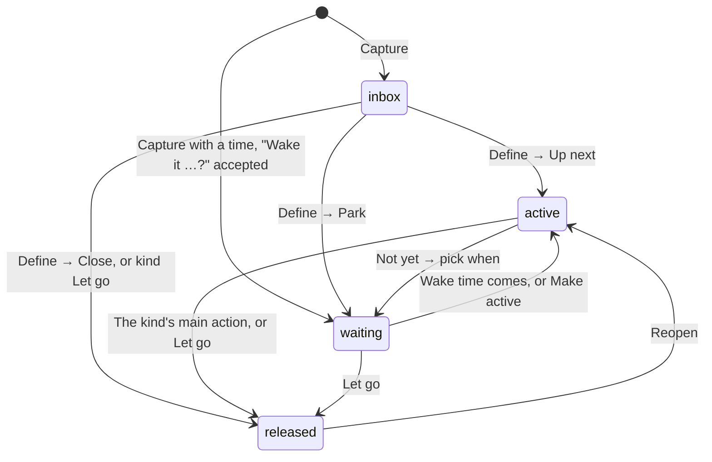

# How loops behave

A map of every rule a loop follows: where it lives, how it moves, what each kind does, which times it carries, and when it nudges. Use it to check how something is meant to work before changing it.

The code is the source of truth. Each section names the function or SQL that enforces the rule, so you can search for it; line numbers drift, names don't. Rules marked **v27** or **v28** arrived in that version.

---

## 1. What a loop is

One row per loop in `public.loops`, mirrored on each phone in `localStorage` (`open_loops_data_v2:<user id>`).

| In the app | Column | What it means |
|---|---|---|
| `rawText` | `raw_text` | The thought, as captured |
| `kind` | `kind` | `do`, `decide`, `ask`, `schedule`, `let_go`, or empty (not defined yet) |
| `status` | `status` | Where it lives: `inbox`, `active`, `waiting`, `released` (section 2) |
| `promptAnswer` | `prompt_answer` | The note from Define: the next step, the decision, who to ask |
| `position` | `position` | Order within a list; higher is nearer the top |
| `wakeAt` | `wake_at` | When a parked loop comes back to Up next (section 5) |
| `details` | `details` | Small facts, listed below |
| `completedAt` | `completed_at` | When it was closed |
| `updatedAt` | `updated_at` | Bumped by the database on every write; drives drying (section 8) |
| | `deleted_at` | Soft delete. Undo clears it. |

`details` holds only these keys. `cleanDetails()` drops anything else, on every write.

| Key | Set when |
|---|---|
| `at` | A Schedule loop's time: when it happens |
| `calAt` | A Schedule loop was sent to a calendar (the card then asks "On your calendar?") |
| `sentAt` | An Ask was sent; it now waits on someone else |
| `nudges` | Follow-ups sent for that Ask |
| `steps` | Next steps finished on a Do |
| `decision` | What a Decide loop settled on |
| `outcome` | `done` or `let_go`, once closed (rings or pebbles on the shelf) |
| `origin` | `decision` when a Do was born from a decision |

---

## 2. Where a loop lives

| Status | Tab | What it means |
|---|---|---|
| `inbox` | Inbox | Captured, not defined yet |
| `active` | Active | In focus. The top card is **Now**; the rest are **Up next**. Only the focus cap shows (3, 5 or 7; default 5), the rest sit behind "Show N more". |
| `waiting` | Parked | Out of your head on purpose, with or without a time to come back |
| `released` | Closed (archive) | Done or let go. `details.outcome` says which. |

A loop entering Active (defined, woken, reopened) lands in **Up next**, right under Now, and never takes over Now on its own (`upNextPosition()`).

---

## 3. How a loop moves

| From | To | How | What else changes | Where |
|---|---|---|---|---|
| none | `inbox` | Capture | | `save-raw-loop` |
| none | `waiting` | Capture text names a time ("call the bank friday") and you accept "Wake it Fri 9:00 AM?" | `wakeAt` = that time. Never automatic. Not for Schedule. | `captureWhen()` |
| `inbox` | any | Define: kind → note (Schedule: the time) → route (Up next, Park, Close). Let go skips the note and closes. | | `renderDefineRaw()`, `finish-define-raw` |
| `active` | `waiting` | Not yet, or menu → Park. Every park asks "when?" ("No date" is allowed). | `wakeAt` | `renderWhen()`, `park-until` |
| `waiting` | `active` | Its wake time passes (while the app is open, on open, and once a minute) | Lands in Up next | `wakeDueLoops()` |
| `waiting` | `active` | Make active | Drops a wake time still ahead, except a Schedule loop's nudge (**v27**) | `restore-active` |
| `active` | `released` | The kind's main action (section 4), Let go, or Done on a notification | `completedAt`, `details.outcome` | `complete-done`, `move-released`, `push_apply_action` |
| `released` | `active` | Reopen | Lands in Up next, `outcome` cleared | `restore-active` |
| any | gone | Delete | Soft delete; Undo for 8 seconds | `confirm-delete` |

---

## 4. Kinds and their main action

Each card has one main button. It does what it says, and every "not yet" asks "when?".

| Kind | Card button | The sheet | Closes when |
|---|---|---|---|
| Do | Done | Did the step (write the next one, `details.steps` + 1), or All done, close it | All done |
| Decide | I decided | Name the decision (options parsed from the note), optionally start a Do from it (`origin: decision`) | The decision is named |
| Ask | Reach out → Did they reply? | Draft the message, send or "I already asked", then park until checking back (Tomorrow, In 3 days, Next week, all at 9:00). On waking: Got it, Nudge them, Wait longer. | They answered |
| Schedule | Set the time / Change the time / On your calendar? / Did it happen? | **v27–v28**: see section 6 | It happened, or it's on your calendar |
| Let go | Let go | Confirm | Right away |

Not yet presets for parking (`wakePresets('park')`): Tonight at 8:00 PM (or In 3 hours when it's later than about 7:15 PM), Tomorrow morning at 9:00, This weekend (Saturday 10:00), Next week (Monday 9:00), or a day and time you pick. **v27**: Schedule loops never get these presets.

---

## 5. The times a loop carries

| Time | Field | Meaning | Who reads it |
|---|---|---|---|
| Event time | `details.at` | When a Schedule loop happens. Schedule only. | The card ("When" / "Was"), the nudge, "Did it happen?" |
| Wake time | `wake_at` | When a parked loop comes back to Up next, and when its wake-up nudge goes out | `wakeDueLoops()`, `push_due_wakeups()`, the sweep, drying |
| Last touched | `updated_at` | Any write, from any device or the server | Drying and the stale check |
| Closed | `completed_at` | When it was closed | The shelf, the Sunday recap |

`wake_at` always means one thing: "back to Up next at this time". For a Schedule loop that time is derived from the event time (next section), so the two never compete.

---

## 6. Schedule loops (v27, nudge timing v28)

**One question: when is it?** A day and a time, both required. There are no quick presets, and the picker starts empty unless there's a real time to start from: one already set, or one read from the note ("Saturday 10am"). A "tomorrow 9:00" you didn't choose would be a false answer one tap from being saved. Times in the past are refused.

**The nudge comes at exactly the time you pick, never before (v28).** `schedulePatch()` is the only code that writes a Schedule loop's time, and it sets `wake_at` to that same time. At that moment the loop comes back to Up next and the nudge goes out, together. However close the time is, it still nudges.

| Situation | Where it waits | `wake_at` |
|---|---|---|
| A time is picked (Define suggests Park) | Parked until that time | The event time itself |
| Up next chosen in Define | Active | The event time itself, so the nudge still comes |
| "Not sure yet" | Parked or Active, no time | None |

Version 27 nudged 30 minutes early (`wake_at` = time − 30 min). The version-28 SQL moves those to the time itself. Until a phone updates, the app and the sender still recognise the old early ones (`LEGACY_EARLY_MIN`), so they keep working.

**What the card says over time:**

| Moment | Reason chip | "When" line | Button |
|---|---|---|---|
| No time yet | | No time set yet. | Set the time |
| Parked, ahead | Nudge Sat 10:00 AM | When: Sat 10:00 AM | Change time (opens the picker) |
| In Active, ahead | Nudge Sat 10:00 AM | When: … | Change the time |
| Sent to a calendar, ahead | Sent to your calendar | When: … | On your calendar? |
| Time has passed | | Was: … | Did it happen? (Yes, close it / It moved / It isn't happening) |

**Every place a time can change goes through `schedulePatch()`:**
- Define, "When is it?" (`finish-define-raw`)
- Not yet, or Change time, on the card (`renderScheduleWhen()`, `park-until` with `data-when="schedule"`)
- The card's sheet, Save the time (`sched-save`)
- The calendar step, where the time can be edited before export (`cal-google`, `cal-ics`)
- The sweep, Move it (`sweepApply()`)

**Guards:**
- A new time clears `calAt`, because the calendar has the old one.
- Make active keeps the nudge.
- Switching the kind away from Schedule removes both the time and the nudge it set (`set-kind-direct`, `finish-define-raw`).
- A Schedule loop waiting for its date never dries out and never counts as stale, in the app or in the sender.
- Confirming "On your calendar?" closes the loop, so a calendared event never gets a second ping from Open Loops.

---

## 7. Nudges

All server-side, all on the free plan. `pg_cron` runs every minute inside Postgres and calls the `push` Edge Function **only when** `push_due_wakeups()` or `push_due_subscriptions()` returns something. A new kind of nudge has to be added to that gate, or it is never sent.

| Nudge | When | Says | Buttons | Expires | Tap opens |
|---|---|---|---|---|---|
| Wake-up | A loop's `wake_at` passes. Loops that wake together share one nudge. | "“X” is back." / "3 loops just woke up." / for a sent Ask, "Did Bilal reply?" | Done, Tomorrow (single loop) | 3 h | The sweep |
| **Schedule (v28)** | A wake-up whose `wake_at` is a Schedule loop's own time (`details.at`) | "“Dentist” is now." / "It's 10:00 AM. Time for “Dentist”.", with the clock in the phone's time zone. Always on its own, never folded into a group. A version-27 early one still says "in 30 min". | Done | 15 min after the time (`NOW_GRACE_MIN`). Later than that it isn't sent; the card asks "Did it happen?". | The loop |
| Check-in: recap | Sunday, at the phone's check-in time, if anything closed this week | "4 things out of your head." | | 6 h | Your head |
| Check-in: stale | At the check-in time, at most weekly, if a loop has been untouched for 21 days | "Rent-free for 23 days." | Done, Tomorrow | 6 h | That loop ("Still yours?") |
| Test | Settings → Nudges → Send a test | "Hello from your loops." | | 10 min | The sweep |

**Windows** (`open-loops-supabase.sql`):
- Wake-ups look back at most 2 hours, so turning wake-ups back on never replays a backlog.
- Check-ins fire within 3 hours after the chosen time, so a missed minute still goes out, at most once a day.

**Buttons:**
- Done closes the loop.
- Tomorrow parks it until 9:00 the next morning in the phone's time zone (`push_apply_action`).
- Button tokens are signed and last 3 days.

**When the app is open and in front of you,** the nudge shows inside the app instead of buzzing the phone. iPhone and Safari still show it briefly, because they drop subscriptions whose pushes never show.

---

## 8. Drying, staleness and the sweep

**Drying** (`dryness()`):
- Untouched for 10 days, a card starts to dry. At 21 days it cracks and asks "Still yours?".
- Touching it in any way (keep, edit, move) makes it fresh again.
- Exempt: parked loops with a wake time, and Schedule loops waiting for their date (**v27**).

**Stale check-in:** the server's version of cracked, at most one nudge a week (`composeNudge()`), with the same exemptions.

**The sweep** (`sweepItems()`) gathers:
- loops that woke since the last sweep (or the last 36 hours);
- up to 3 cracked loops.

A banner on Active offers it. Each card gets Make it Now, Up next, Park again (Move it for Schedule), or Let go. "Later" hides the banner for the rest of the day, unless something new comes up.

---

## 9. Opening the app (v27)

"Not loaded yet" is its own state, never an empty list. **Loops that exist are always shown; empty states and counts wait for real data.** See the boot section near the top of the script (`bootState`, `setBoot()`).

| State | When | You see |
|---|---|---|
| `starting` | Before the app knows which account this is (usually a few ms) | Logo splash on the launch-screen color, lifted after 3 s at the latest |
| `cached` | Account known and loops saved on this phone | Your loops at once; the header says Syncing… |
| `loading` | Account known and nothing saved yet (new phone, first sign-in) | Pulsing loop bars, no counts |
| `ready` | The server has answered, or nobody is signed in | The real list, or the empty state if it is truly empty |
| `unreachable` | Nothing saved here and the download failed | "Can't reach your loops right now", with Try again |

**Rules:**
- The last signed-in account is remembered on the phone (`open_loops_data_last_user`), so the first frame can show its saved loops while the sign-in check runs. It is forgotten on sign-out. It is skipped when arriving from a sign-in link, which may be for someone else.
- A saved copy with no loops proves nothing, so it waits for the server like a new phone.
- Edits made during a full download wait in the queue until it lands, so the download can't paint over them (`pulling` in the Sync module).
- A fresh open starts on Active. A reload within the same sitting (an update, a refresh) keeps the tab, which is stored in `sessionStorage`.
- Active empty while Inbox has loops says "Active is clear. 2 in Inbox to sort." "Your head is clear" is only for a truly empty head. Parked loops don't count: they're out of your head on purpose.

---

## 10. Sync in one paragraph

Every change is saved on the phone first, queued, and sent to Supabase. A full pull (on sign-in, on opening, after reconnecting) treats the server as the truth, but keeps any queued edits on top. Writes that fail five times (`MAX_QUEUE_ATTEMPTS`) move to a dead-letter queue, shown as "Still saving". Realtime brings other devices' changes in live. Your own writes' echoes are ignored for a few seconds, so they can't undo a newer edit.

---

## 11. Where each rule lives

| Rule | Where |
|---|---|
| What `details` may hold | `cleanDetails()` |
| Up next placement | `upNextPosition()`, `rebalanceActivePositions()` |
| Park presets | `wakePresets()` |
| Schedule time, nudge and route | `schedulePatch()`, `scheduleNudgeFor()`, `wakeIsScheduleNudge()` |
| Schedule pickers and their honest note | `scheduleFieldsHtml()`, `scheduleNoteText()` |
| A parked loop waking in the app | `wakeDueLoops()` |
| Card button, reason chip, "When" line | `actionLabel()`, `reasonFor()`, `nextLineHtml()` |
| Kind sheets | `renderPrimaryAction()` |
| Drying | `dryness()` |
| Sweep | `sweepItems()`, `sweepApply()`, `renderSweep()` |
| Opening the app | `bootState`, `setBoot()`, `bootFromSavedCopy()`, `notKnownYetHtml()` |
| Who is due a nudge | `push_due_wakeups()`, `push_due_subscriptions()` in `open-loops-supabase.sql` |
| What a nudge says | `supabase/functions/push/compose.ts` |
| Sending, buttons, tokens | `supabase/functions/push/index.ts` |
| Showing a nudge and its buttons | `open-loops-sw.js` |

---

## 12. Changing a rule safely

- **A new place that sets a Schedule time** must go through `schedulePatch()`, or the nudge stays at the old time.
- **A new kind of nudge** must be added to the `pg_cron` gate in `open-loops-supabase.sql`, or the function is never called.
- **Anything that writes `wake_at`** should ask whether it's a Schedule loop's nudge (`wakeIsScheduleNudge()`) before clearing it.
- **A new empty state or count** must check `dataKnown()`, so it can't show while loading.
- **A new `details` key** has to be added to `cleanDetails()`, or it's silently dropped. Older app versions will still drop it when they write.
- **A new column** has to be added to the "missing column" fallback in the Sync module (`NEW_COLUMNS`) if the app may ship before the SQL. Run the SQL first anyway.
- **A new table:** from 30 Oct 2026, Supabase no longer gives new `public` tables Data API access by default. Grant it in the same migration (`grant select, insert, update, delete on public.<table> to authenticated;`), or the app gets "permission denied".
- **Every release:** bump `CACHE` in `open-loops-sw.js` and `APP_VERSION` in `open-loops.html` together.
- **Deploy order:** usually SQL first, then the `push` function, then the app. A release's upgrade note in the README says when it differs (version 28 deploys the function first).
